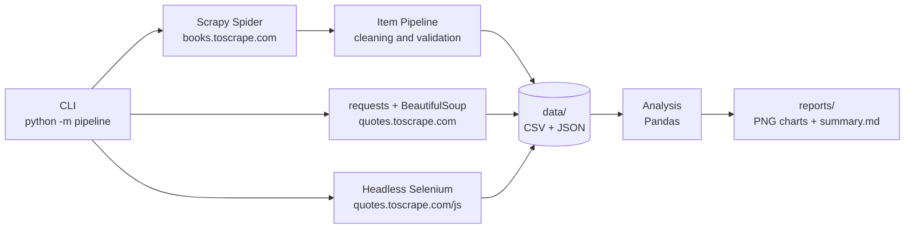

# 🕷️ Web Scraping Pipeline

🇧🇷 [Leia em português](README.pt-BR.md)


An automated pipeline for **web data extraction, cleaning and analysis**, run from a single CLI.
The project combines three scraping techniques, each suited to a different kind of page:

| Technique | Tool | Source | When to use |
| --- | --- | --- | --- |
| **Crawling** with pagination and categories | Scrapy | [books.toscrape.com](https://books.toscrape.com) | Many links/pages, high performance |
| **Static scraping** | requests + BeautifulSoup | [quotes.toscrape.com](https://quotes.toscrape.com) | Server-rendered HTML, simple extraction |
| **Dynamic page scraping** | Selenium (headless Chrome) | [quotes.toscrape.com/js](https://quotes.toscrape.com/js/) | Content rendered by JavaScript |

After collection, the data is **normalized** (prices, ratings, stock, tags), **analyzed with Pandas**
and turned into **Matplotlib charts** and a Markdown report.

> The websites used were built specifically for web scraping practice.

---

## 🏗️ Architecture



## 📁 Project structure

```
pipeline/
├── cli.py               # Command-line interface (argparse + logging)
├── config.py            # URLs, paths and network settings
├── cleaning.py          # Pure cleaning/normalization functions
├── books/               # Scrapy: spider, item, pipeline and runner
├── quotes/              # BeautifulSoup and Selenium scrapers + export
└── analysis/            # Metrics (Pandas), charts (Matplotlib) and report
tests/                   # pytest with HTML fixtures (no network access)
scripts/                 # Test fixture updater
.github/workflows/ci.yml # CI: ruff (lint + format) and pytest on 3 Python versions
```

## 🚀 Getting started

```bash
# 1. Virtual environment and dependencies
python -m venv .venv
.venv\Scripts\activate        # Windows
# source .venv/bin/activate   # Linux/macOS
pip install -r requirements-dev.txt

# 2. Full pipeline: books → quotes → analysis
python -m pipeline run --all

# Without Selenium (if Google Chrome is not installed)
python -m pipeline run --all --no-selenium
```

### Available commands

| Command | Description |
| --- | --- |
| `python -m pipeline run --all` | Runs every step in sequence |
| `python -m pipeline scrape-books` | Crawls the full book catalog with Scrapy |
| `python -m pipeline scrape-quotes --engine bs4\|selenium\|both` | Collects the quotes |
| `python -m pipeline analyze` | Generates statistics, charts and `reports/summary.md` |

Useful options: `--max-pages N`, `--show-browser` (visible Chrome), `-v` (DEBUG logs), `--log-file pipeline.log`.

> Selenium 4 automatically downloads the matching driver (Selenium Manager). You only need Google Chrome installed.
> If Chrome is not found, the step is skipped with a warning and the rest of the pipeline keeps running.

> The CLI log messages are in Portuguese.

## 📊 Results

Generated output:

- `data/books.csv|json`: title, price, rating, availability, category and URL of each book
- `data/quotes.csv|json` and `data/quotes_js.csv|json`: quote, author and tags
- `reports/*.png`, `reports/*.csv` and `reports/summary.md`: analyses and charts

<p align="center">
  
  
</p>
<p align="center">
  
  
</p>

## ✅ Tests and code quality

```bash
pytest          # unit tests for parsers and cleaning (saved HTML, no network)
ruff check .    # lint
ruff format .   # formatting
```

On every `push`, GitHub Actions runs linting and tests on Python 3.12, 3.13 and 3.14.

## 🧭 Scraping best practices

- Identified `User-Agent`, request timeout and delay between requests (`config.py`)
- Scrapy `AUTOTHROTTLE` enabled and `robots.txt` respected
- Parsers separated from the network layer, so they can be tested offline
- Cleaning logic written as pure, testable functions

## 👩‍💻 Author

**Marcielle Santos**: [LinkedIn](https://www.linkedin.com/in/marciellesantos-dev) · marcielle.san@gmail.com

[MIT](LICENSE) License.
