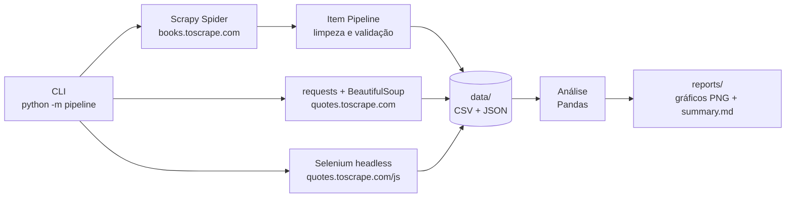
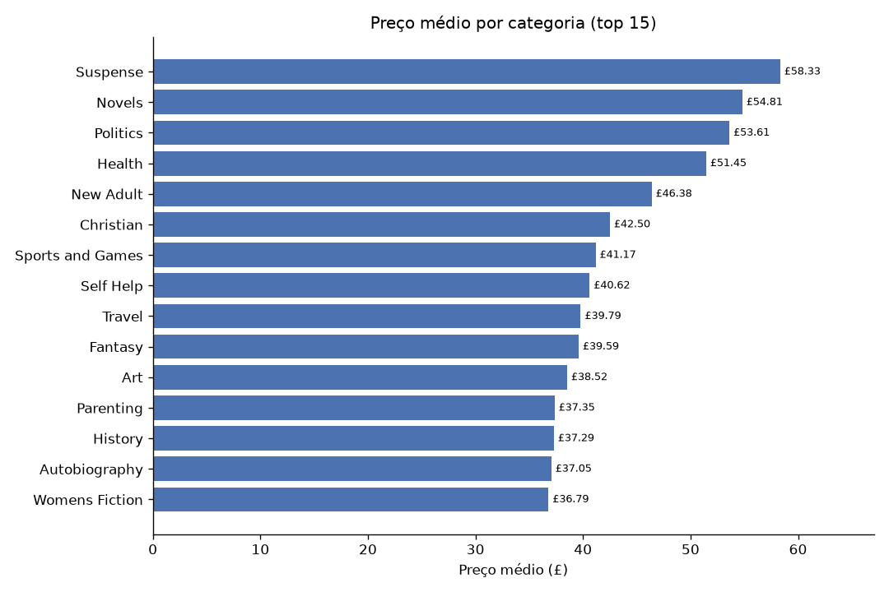
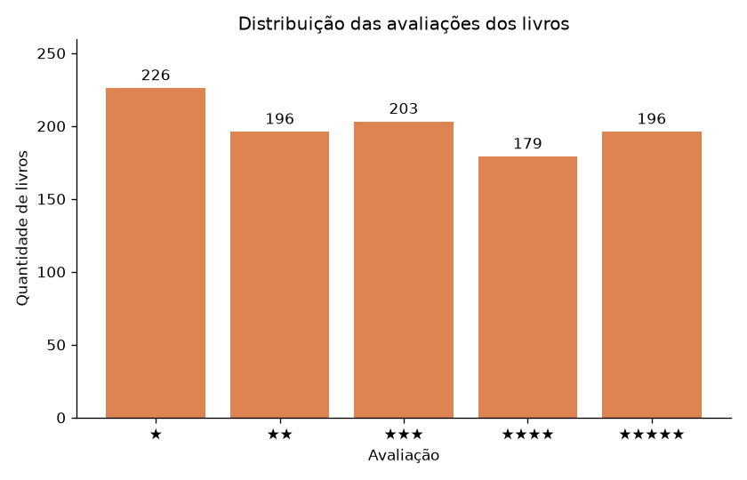
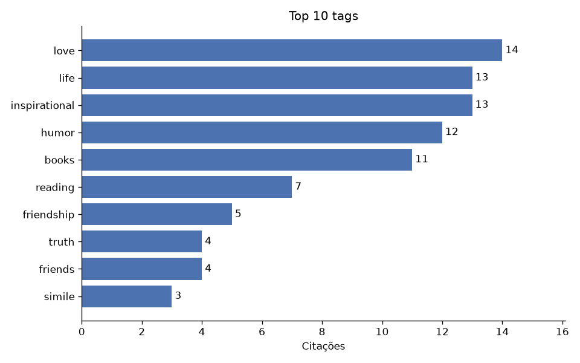
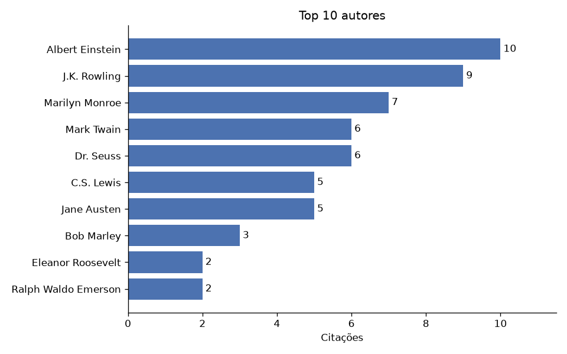

# 🕷️ Web Scraping Pipeline

🇺🇸 [Read in English](README.md)


Pipeline automatizado de **extração, limpeza e análise de dados da web**, executado por uma única CLI.
O projeto reúne três técnicas de coleta, cada uma adequada a um tipo de página:

| Técnica | Ferramenta | Fonte | Quando usar |
| --- | --- | --- | --- |
| **Crawling** com paginação e categorias | Scrapy | [books.toscrape.com](https://books.toscrape.com) | Muitos links/páginas, alta performance |
| **Scraping estático** | requests + BeautifulSoup | [quotes.toscrape.com](https://quotes.toscrape.com) | HTML pronto no servidor, coleta simples |
| **Scraping de página dinâmica** | Selenium (Chrome headless) | [quotes.toscrape.com/js](https://quotes.toscrape.com/js/) | Conteúdo renderizado por JavaScript |

Depois da coleta, os dados são **normalizados** (preços, notas, estoque, tags), **analisados com Pandas**
e transformados em **gráficos com Matplotlib** e um relatório em Markdown.

> Os sites usados foram criados especificamente para a prática de web scraping.

---

## 🏗️ Arquitetura



## 📁 Estrutura

```
pipeline/
├── cli.py               # Interface de linha de comando (argparse + logging)
├── config.py            # URLs, caminhos e parâmetros de rede
├── cleaning.py          # Funções puras de limpeza/normalização
├── books/               # Scrapy: spider, item, pipeline e runner
├── quotes/              # BeautifulSoup e Selenium + exportação
└── analysis/            # Métricas (Pandas), gráficos (Matplotlib) e relatório
tests/                   # pytest com fixtures HTML (sem acesso à rede)
scripts/                 # Atualização das fixtures de teste
.github/workflows/ci.yml # CI: ruff (lint + format) e pytest em 3 versões do Python
```

## 🚀 Como executar

```bash
# 1. Ambiente virtual e dependências
python -m venv .venv
.venv\Scripts\activate        # Windows
# source .venv/bin/activate   # Linux/macOS
pip install -r requirements-dev.txt

# 2. Pipeline completo: livros → citações → análise
python -m pipeline run --all

# Sem o Selenium (caso não tenha o Google Chrome instalado)
python -m pipeline run --all --no-selenium
```

### Comandos disponíveis

| Comando | Descrição |
| --- | --- |
| `python -m pipeline run --all` | Executa todas as etapas em sequência |
| `python -m pipeline scrape-books` | Coleta o catálogo completo de livros com Scrapy |
| `python -m pipeline scrape-quotes --engine bs4\|selenium\|both` | Coleta as citações |
| `python -m pipeline analyze` | Gera estatísticas, gráficos e `reports/summary.md` |

Opções úteis: `--max-pages N`, `--show-browser` (Chrome visível), `-v` (logs DEBUG), `--log-file pipeline.log`.

> O Selenium 4 baixa automaticamente o driver compatível (Selenium Manager). Basta ter o Google Chrome instalado.
> Se o Chrome não for encontrado, a etapa é pulada com um aviso e o resto do pipeline continua.

## 📊 Resultados

Saídas geradas:

- `data/books.csv|json`: título, preço, avaliação, estoque, categoria e URL de cada livro
- `data/quotes.csv|json` e `data/quotes_js.csv|json`: citação, autor e tags
- `reports/*.png`, `reports/*.csv` e `reports/summary.md`: análises e gráficos

<p align="center">
  
  
</p>
<p align="center">
  
  
</p>

## ✅ Testes e qualidade

```bash
pytest          # testes unitários dos parsers e da limpeza (usam HTML salvo, sem rede)
ruff check .    # lint
ruff format .   # formatação
```

A cada `push`, o GitHub Actions roda lint e testes nas versões 3.12, 3.13 e 3.14 do Python.

## 🧭 Boas práticas de scraping adotadas

- `User-Agent` identificado, timeout e intervalo entre requisições (`config.py`)
- `AUTOTHROTTLE` e respeito ao `robots.txt` no Scrapy
- Parsers separados da camada de rede, o que permite testar sem internet
- Limpeza em funções puras e testáveis

## 👩‍💻 Autora

**Marcielle Santos**: [LinkedIn](https://www.linkedin.com/in/marciellesantos-dev) · marcielle.san@gmail.com

Licença [MIT](LICENSE).
